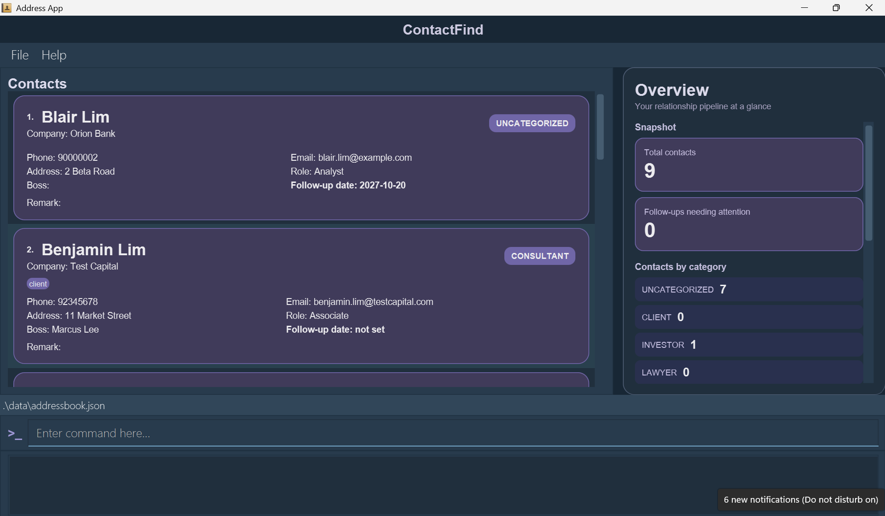
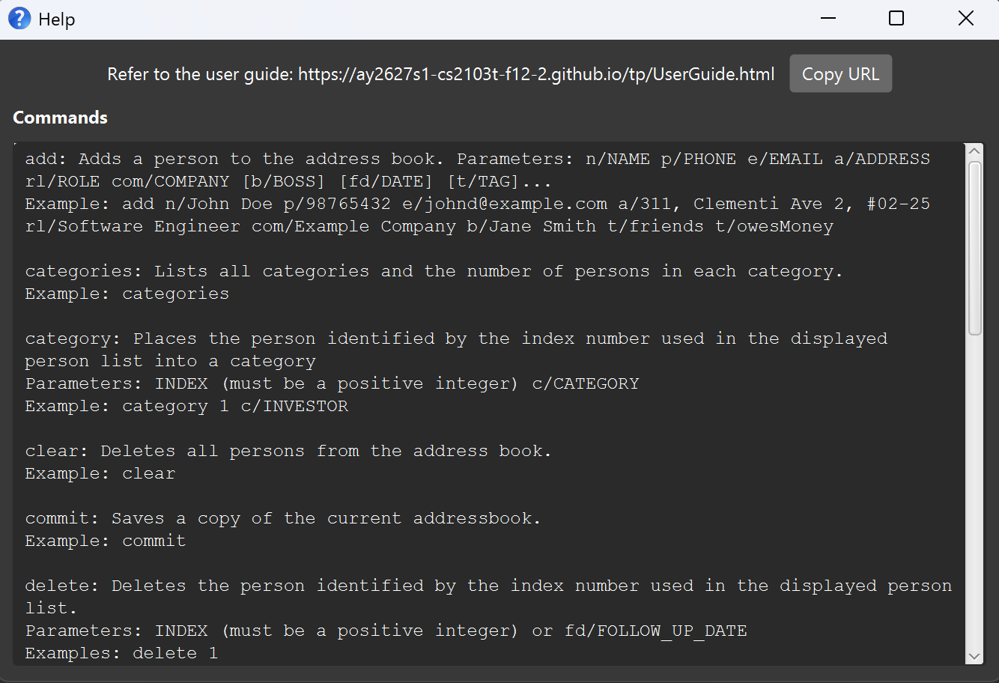

# ContactFind User Guide

ContactFind is a **desktop contact manager for investment bankers**. It helps you keep track of clients, investors, lawyers, and other professional contacts, including each contact's role, company, and boss. ContactFind is **optimized for use through a Command Line Interface (CLI)** while retaining the benefits of a Graphical User Interface (GUI). If you type quickly, ContactFind can help you manage contacts faster than traditional GUI applications.

<!-- * Table of Contents -->
<page-nav-print />

--------------------------------------------------------------------------------------------------------------------

## Quick start

1. Ensure that Java `25` or later is installed on your computer. 
   **Mac users:** Ensure you have the precise JDK version prescribed [here](https://se-education.org/guides/tutorials/javaInstallationMac.html).

1. Download the latest `.jar` file from [here](https://github.com/AY2627S1-CS2103T-F12-2/tp/releases).

1. Copy the file to the folder you want to use as the _home folder_ for ContactFind.

1. Open a terminal, `cd` to the folder containing the JAR file, and run `java -jar contactfind.jar`. 
   A GUI similar to the one below should appear in a few seconds. Note how the app contains some sample data. 
   

1. Type a command in the command box and press Enter to execute it. For example, type **`help`** and press Enter to open the help window. 
   Some example commands you can try:

   * `list` : Lists all contacts.

   * `add n/John Doe p/98765432 e/johnd@example.com a/John street, block 123, #01-01 rl/Analyst com/Example Bank` : Adds a contact named `John Doe`.

   * `delete 3` : Deletes the 3rd contact shown in the current list.

   * `clear` : Deletes all contacts.

   * `exit` : Exits the app.

1. Refer to the [Features](#features) section below for details of each command.

--------------------------------------------------------------------------------------------------------------------

## Main window overview

ContactFind opens in a two-pane layout:

* The left pane displays all contacts as rounded cards. Each card highlights the contact's name and shows their company, category, tags, and other details.
* The right **Overview** pane displays the total number of contacts, the number of follow-ups needing attention, and the number of contacts in each category.
* The **One week follow ups** section lists contacts whose follow-up date is overdue or falls within the next seven days. Overdue dates are highlighted in red, while dates due within the next seven days are highlighted in yellow.

The follow-up list is integrated into the Overview pane; there is no separate Dashboard page or Dashboard button. You can continue to manage contacts using the command box at the bottom of the window.

--------------------------------------------------------------------------------------------------------------------

## Features

<box type="info" seamless>

**Notes about the command format:** 

* Words in `UPPER_CASE` are the parameters to be supplied by the user. 
  For example, in `add n/NAME`, replace `NAME` with a value such as `John Doe`.

* Items in square brackets are optional. 
  For example, `n/NAME [t/TAG]` can be used as `n/John Doe t/friend` or as `n/John Doe`.

* Items followed by `...` can appear zero or more times. 
  For example, `[t/TAG]... ` may be omitted, or written as `t/friend` or `t/friend t/family`.

* Parameters can be in any order. 
  For example, if the command specifies `n/NAME p/PHONE_NUMBER`, `p/PHONE_NUMBER n/NAME` is also acceptable.

* `INDEX` refers to the index number shown in the displayed contact list. It **must be a positive integer** 1, 2, 3, ...

* Extraneous parameters for commands that take no parameters, such as `help`, `list`, `categories`, `exit`, and `clear`, are ignored. 
  For example, `help 123` is interpreted as `help`.

* If you are using a PDF version of this document, be careful when copying and pasting commands that span multiple lines as space characters surrounding line-breaks may be omitted when copied over to the application.
</box>

### Prefix reference

Use a prefix immediately before its value. Not every prefix is accepted by every command; refer to each command's format.

Prefix | Field            | Used by
-------|------------------|--------
`n/` | Name             | `add`, `edit`, `find`, `delete`
`p/` | Phone number     | `add`, `edit`, `delete`
`e/` | Email address    | `add`, `edit`, `delete`
`a/` | Address          | `add`, `edit`
`rl/` | Role             | `add`, `edit`, `find`, `delete` (preview)
`com/` | Company          | `add`, `edit`, `find`, `delete` (preview)
`b/` | Boss             | `add`, `edit`
`fd/` | Follow-up date   | `add`, `edit`, `find`, `delete`, `sort`
`t/` | Tag              | `add`, `edit`
`r/` | Remark           | `remark`
`c/` | Category         | `category`
`d/` | Interaction date | `interaction`
`ty/` | Interaction type | `interaction`
`nt/` | Interaction note | `interaction`
`fn/` | File name        | `export`

### Field constraints

ContactFind checks every value you enter. If a value does not meet its constraint, the command is rejected and an error message is shown.

Field | Constraint                                                                                                                     | Valid example
------|--------------------------------------------------------------------------------------------------------------------------------|--------------
Name | Letters only, with at least a first and last name separated by a space. | `John Doe`
Phone number | Digits only, exactly 8 digits long.                                                                                            | `98765432`
Email address | Must be in the form `local-part@domain`.                                                                                       | `johnd@example.com`
Address | Any value, but must not be blank.                                                                                              | `John street, block 123, #01-01`
Role | Letters and digits only; surrounding and repeated spaces are normalized.                                                       | `Vice President`
Company | Letters and digits only, at least 3 characters long; surrounding and repeated spaces are normalized.                           | `Example Bank`
Boss | Same as Name, or empty.                                                                                                        | `Alex Smith`
Follow-up date | A valid calendar date in exactly `yyyy-MM-dd` format, with a four-digit year.                                      | `2026-10-20`
Tag | Letters and digits only, with no spaces.                                                                                       | `priority`
Remark | Any value.                                                                                                                     | `Prefers email over calls`
Category | One of `UNCATEGORIZED`, `CLIENT`, `INVESTOR`, `LAWYER`, `ACCOUNTANT`, `CONSULTANT`, `OTHER` (case-insensitive).                | `INVESTOR`

<box type="info" seamless>

**Note:** Contact names must be unique, regardless of letter case. For example, `Alice Tan` and `alice tan` are duplicates. ContactFind rejects an `add` or `edit` command if its name belongs to another contact. You can still change the capitalization of a contact's own name. If your existing `data/addressbook.json` contains case-only duplicates, resolve them before opening it with this version; ContactFind cannot load that file until the names are unique.
</box>

### Viewing help: `help`

Opens a Help window.  
Help window lists every commands' usage text and contains a link to the User Guide.

Format: `help`

### Adding a contact: `add`

Adds a contact to ContactFind.

Format: `add n/NAME p/PHONE_NUMBER e/EMAIL a/ADDRESS rl/ROLE com/COMPANY [b/BOSS] [fd/FOLLOW_UP_DATE] [t/TAG]...`

* Name, phone number, email address, address, role, and company are required.
* Boss, follow-up date, and tags are optional.
* A contact cannot be their own boss or create a circular management chain. Boss names are matched case-insensitively.
* New contacts start in the `UNCATEGORIZED` category. Use [`category`](#categorizing-a-contact-category) to change it.

<box type="tip" seamless>

**Tip:** You can provide any number of tags.
To assign multiple tags, repeat the `t/` prefix.
</box>

Examples:
* `add n/John Doe p/98765432 e/johnd@example.com a/John street, block 123, #01-01 rl/CEO com/ABC Bank`
* `add n/Mary Smith p/12345678 e/betsycrowe@example.com a/ABC Street rl/CFO com/Hello Company b/Alex Smith t/client t/priority`
* `add n/Chris Tan p/81234567 e/chris@example.com a/Orchard Road rl/Analyst com/ABC Bank fd/2026-10-20`

### Listing all contacts: `list`

Shows a list of all contacts in ContactFind.

Format: `list`

### Editing a contact: `edit`

Edits an existing contact in ContactFind.

Format: `edit INDEX [n/NAME] [p/PHONE_NUMBER] [e/EMAIL] [a/ADDRESS] [rl/ROLE] [com/COMPANY] [b/BOSS] [fd/FOLLOW_UP_DATE] [t/TAG]...`

* Edits the contact at the specified `INDEX`.
* At least one of the optional fields must be provided.
* Existing values will be updated to the input values.
* To remove a contact's boss, enter `b/` without a name after it.
* To set a contact's follow-up date, enter `fd/YYYY-MM-DD`.
* To remove a contact's follow-up date, enter `fd/` without a date after it.
* Follow-up dates must use exactly the `YYYY-MM-DD` format; invalid dates are rejected.
* When editing tags, all of the contact's existing tags are removed and replaced with the tags you enter; adding tags this way is not cumulative.
* To remove all of a contact's tags, enter `t/` without a tag after it.
* The success message shows the complete updated contact record, including tags, category, remark, follow-up date, and interaction history.

Examples:
*  `edit 1 p/91234567 e/johndoe@example.com` Edits the phone number and email address of the 1st contact to be `91234567` and `johndoe@example.com` respectively.
*  `edit 2 n/Betsy Crower t/` Edits the name of the 2nd contact to be `Betsy Crower` and clears all existing tags.
*  `edit 3 rl/Managing Director com/Example Bank b/` Updates the role and company of the 3rd contact and removes their boss.
* `edit 1 fd/2026-10-20` sets the follow-up date of the 1st contact.
* `edit 1 fd/` removes the follow-up date of the 1st contact.

### Adding a remark to a contact: `remark`

Adds, replaces, or removes the remark of an existing contact.

Format: `remark INDEX [r/REMARK]`

* Sets the remark of the contact at the specified `INDEX`.
* The contact's existing remark is replaced by the new one.
* To remove a contact's remark, enter `remark INDEX` or `remark INDEX r/` without any text.

Examples:
* `remark 1 r/Prefers email over calls` sets the remark of the 1st contact.
* `remark 1` removes the remark of the 1st contact.

### Categorizing a contact: `category`

Places an existing contact into a category.

Format: `category INDEX c/CATEGORY`

* Categorizes the contact at the specified `INDEX`.
* `CATEGORY` must be one of: `UNCATEGORIZED`, `CLIENT`, `INVESTOR`, `LAWYER`, `ACCOUNTANT`, `CONSULTANT`, `OTHER`.
* Category names are case-insensitive.
* Each contact can have only one category. Categorizing a contact replaces that contact's current category.

Examples:
* `category 1 c/INVESTOR` categorizes the 1st contact in the displayed list as an investor.
* `category 2 c/UNCATEGORIZED` removes the 2nd contact's specific category.

### Listing all categories: `categories`

Shows all available categories and the number of contacts assigned to each category.

Format: `categories`

### Logging an interaction: `interaction`

Records an interaction (such as a meeting or call) with an existing contact.

Format: `interaction INDEX d/DATE ty/TYPE [nt/NOTE]`

* Logs an interaction with the contact at the specified `INDEX`.
* `d/` and `ty/` are required. Each prefix can appear only once.
* `DATE` must be a valid calendar date in `yyyy-MM-dd` format.
* `TYPE` must be one of `MEETING`, `CALL`, `EMAIL`, `PRESENTATION` (case-insensitive).
* `NOTE` is optional and can be empty.
* Each interaction is added to the contact's history; existing interactions are kept.

Examples:
* `interaction 1 d/2026-10-20 ty/MEETING nt/Discussed proposal`
* `interaction 3 d/2026-11-02 ty/call nt/Follow-up on term sheet`

### Listing all interactions: `interactions`

Shows recorded interactions for all contacts, including those hidden by the current filter. Shows `No interactions recorded.` when empty.

Format: `interactions`

### Listing interactions with a specific person: `interactions INDEX`

Shows recorded interactions with the person recorded at that specific index (based on the indexing of the current
filter result if applicable.) Shows `No interactions recorded.` when empty.
Index references the index currently show on screen (accounting for filter from `find`)
i.e. if there is only one person displayed after `find`, then the only index available for
interactions is 1.

Format: `interactions INDEX`

### Finding contacts: `find`

Finds contacts by their name, phone number, email, role, company, boss, tag, category, or follow-up date.

Format: `find PREFIX/VALUE [PREFIX/VALUE]...`

* Every search value must be preceded by a prefix. `n/` searches names, `p/` phone numbers, `e/` emails, `rl/` roles, `com/` companies, `b/` boss names, `t/` tags, `c/` categories, and `fd/` follow-up dates.
* Each prefix must have a non-empty value. A value may contain spaces; for example, `find n/Amy Rivera` searches for `Amy Rivera` in a contact's name.
* Searches are case-insensitive. Except for categories and follow-up dates, a value matches when it appears anywhere in the selected field; for example, `find n/Han` matches `Hans`.
* `c/` and `fd/` must match exactly. `c/` accepts: `UNCATEGORIZED`, `CLIENT`, `INVESTOR`, `LAWYER`, `ACCOUNTANT`, `CONSULTANT`, and `OTHER`.
* Repeated instances of the same prefix are combined with OR. For example, `find n/Hans Gruber n/Bo Yang` returns contacts whose names contain either `Hans Gruber` or `Bo Yang`.
* Different prefixes are combined with AND. For example, `find n/Hans com/Example` finds contacts whose name contains `Hans` and whose company contains `Example`.

Examples:
* `find n/John` returns `John Doe` and `Johnny Tan`.
* `find p/9123` returns every contact whose phone number contains `9123`.
* `find e/example` returns every contact whose email contains `example`.
* `find rl/analyst` returns every contact whose role contains `analyst`.
* `find com/example` returns every contact whose company contains `example`.
* `find b/Alex` returns every contact whose boss name contains `Alex`.
* `find t/friend t/important` returns every contact with a tag containing `friend` or `important`.
* `find n/alex yeoh n/david li` returns `Alex Yeoh` and `David Li`. 

* `find c/client c/investor` returns every contact in either the `CLIENT` or `INVESTOR` category.
* `find fd/2026-10-20` returns every contact with a follow-up date of `2026-10-20`.
* `find rl/analyst rl/engineer com/ABC Labs` returns every contact whose role contains `analyst` or `engineer` and whose company contains `ABC Labs`.

### Deleting a contact: `delete`

Deletes the specified contact from ContactFind.

Format: `delete INDEX`, `delete n/NAME`, `delete p/PHONE`, `delete e/EMAIL`, `delete rl/ROLE`, `delete com/COMPANY`, or `delete fd/YYYY-MM-DD`

All keyword parameters must be exact; partial keywords are not supported.

* `delete INDEX` deletes the contact at the specified index in the current list.
* `delete p/PHONE` deletes the contact with the exact phone number.
* `delete e/EMAIL` deletes the contact with the exact email address.
* `delete n/NAME` deletes the contact with the exact name.

Examples: 
* `list` followed by `delete 2` deletes the 2nd contact in ContactFind.
* `find Betsy` followed by `delete 1` deletes the 1st contact in the results of the `find` command.
* `delete p/98765432` deletes the contact whose phone number is exactly `98765432`.
* `delete e/johnd@example.com` deletes the contact whose email address is exactly `johnd@example.com`.
* `delete n/John Doe` deletes the contact whose name is exactly `John Doe`.

#### Bulk delete

Use a role or company to preview the matching contacts before deleting them.

Format: `delete rl/ROLE` or `delete com/COMPANY`

* While a bulk-delete preview is active, `delete INDEX`, `delete n/NAME`, `delete p/PHONE`, and `delete e/EMAIL` can delete one of the contacts in that preview instead. Enter `list` to leave the preview without deleting all of its contacts.
* Use `delete all` to delete every contact currently displayed by the active ROLE or COMPANY preview.

`delete fd/YYYY-MM-DD` is also a bulk-delete command: it immediately deletes every contact displayed in the current list whose follow-up date exactly matches the date.

Examples:
* `delete com/Example Bank` previews every contact at `Example Bank` without deleting them.
* `delete com/Example Bank` followed by `delete all` deletes every contact in that company preview.
* `delete rl/Software Engineer` followed by `delete 1` deletes the 1st contact in that role preview.
* `delete fd/2026-10-20` deletes every displayed contact with that follow-up date.

### Sorting contacts: `sort`

Sorts contacts by follow-up date. Contacts without a follow-up date are placed at the end.

Format: `sort fd/[asc|desc]`

* `sort fd/` and `sort fd/asc` sort by follow-up date from earliest to latest.
* `sort fd/desc` sorts by follow-up date from latest to earliest.

Examples:
* `sort fd/` sorts all contacts by their next follow-up date.
* `sort fd/desc` sorts all contacts in reverse date order.

### Clearing all entries: `clear`

Clears all contacts from ContactFind.

Format: `clear`

### Saving an undo checkpoint: `commit`

Saves the current contact list as a checkpoint that undo can return to.

Format: `commit`

### Undoing a change: `undo`

Restores the contact-list state before the most recent saved change. The `add`, `edit`, `delete`, `clear`,
`remark`, `category`, `interaction`, `sort`, and `commit` commands create undo checkpoints.

Format: `undo`

### Redoing a change: `redo`

Reapplies the contact-list state most recently undone. Redo is unavailable after a command that creates an undo
checkpoint is run.

Format: `redo`

### Exporting contacts: `export`

Exports all contacts from ContactFind to a CSV file.

Format: `export`, `export fn/FILENAME`

All keyword parameters must be exact; partial keywords are not supported.

* `export` exports currently displayed contacts to "export.csv" located in the data folder.
* `export fn/FILENAME` exports currently displayed to "FILENAME.CSV" in the data folder.
* Currently displayed contacts: all contacts, or the remaining contacts after find is executed.
* FILENAME can only contain alphanumeric characters, dash and underscore.
* Trailing ".csv" characters in the input file name will be automatically truncated.

Examples:
* `export` (default)
* `export fn/favorites`
* `export fn/important.csv`

### Exiting the program: `exit`

Exits the program.

Format: `exit`

### Saving the data

ContactFind automatically saves data after every successfully executed command. You do not need to save manually.

### Editing the data file

ContactFind data is saved automatically as a JSON file `[JAR file location]/data/addressbook.json`. Advanced users are welcome to update data directly by editing that data file.

<box type="warning" seamless>

**Caution:**
If your changes make the data file invalid, ContactFind starts with an empty contact list at the next run. The invalid file remains on disk until a command completes successfully (ContactFind then saves the current data). Still, we recommend backing up the file before editing it. 
Furthermore, certain edits can cause ContactFind to behave in unexpected ways (e.g., if a value entered is outside of the acceptable range). Therefore, edit the data file only if you are confident that you can update it correctly.
</box>

--------------------------------------------------------------------------------------------------------------------

## FAQ

**Q**: How do I transfer my data to another computer? 
**A**: Install the app on the other computer and overwrite the data file it creates with the data file from your previous ContactFind home folder.

**Q**: How do I add a tag without losing a contact's existing tags? 
**A**: The `edit` command replaces all of a contact's existing tags, so include every tag you want to keep. For example, if a contact is tagged `client`, use `edit INDEX t/client t/priority` to add `priority`.

**Q**: Why was my phone number rejected? 
**A**: Phone numbers must contain digits only and be exactly 8 digits long. Remove spaces, dashes, and the `+` country code prefix. See [Field constraints](#field-constraints).

--------------------------------------------------------------------------------------------------------------------

## Known issues

1. **When using multiple screens**, if you move the application to a secondary screen, and later switch to using only the primary screen, the GUI will open off-screen. The remedy is to delete the `preferences.json` file created by the application before running the application again.
2. **If you minimize the Help Window** and then run the `help` command (or use the `Help` menu, or the keyboard shortcut `F1`) again, the original Help Window will remain minimized, and no new Help Window will appear. The remedy is to manually restore the minimized Help Window.

--------------------------------------------------------------------------------------------------------------------

## Command summary

Action     | Format, Examples
-----------|----------------------------------------------------------------------------------------------------------------------------------------------------------------------
**Add**    | `add n/NAME p/PHONE_NUMBER e/EMAIL a/ADDRESS rl/ROLE com/COMPANY [b/BOSS] [fd/FOLLOW_UP_DATE] [t/TAG]...`   e.g., `add n/James Ho p/22224444 e/jamesho@example.com a/123, Clementi Rd, 1234665 rl/Analyst com/Example Bank fd/2026-10-20 t/client`
**Categories** | `categories`
**Category** | `category INDEX c/CATEGORY`  e.g., `category 1 c/INVESTOR`
**Clear**  | `clear`
**Commit** | `commit`
**Delete** | `delete INDEX`, `delete n/NAME`, `delete p/PHONE`, or `delete e/EMAIL` delete one contact; `delete rl/ROLE` or `delete com/COMPANY` preview an exact-match scope; `delete all` deletes that active scope; `delete fd/YYYY-MM-DD` deletes every displayed contact with that date.  e.g., `delete com/Example Bank`, then `delete all`
**Edit**   | `edit INDEX [n/NAME] [p/PHONE_NUMBER] [e/EMAIL] [a/ADDRESS] [rl/ROLE] [com/COMPANY] [b/BOSS] [fd/FOLLOW_UP_DATE] [t/TAG]...`  e.g., `edit 2 n/James Lee e/jameslee@example.com`
**Exit**   | `exit`
**Export**   | `export`, `export fn/FILENAME`
**Find**   | `find PREFIX/VALUE [PREFIX/VALUE]...`  Prefixes: `n/`, `p/`, `e/`, `rl/`, `com/`, `b/`, `t/`, `c/`, `fd/`.  e.g., `find n/James Jake`, `find c/CLIENT c/INVESTOR`, `find fd/2026-10-20`.  Repeated prefixes are combined with OR; different prefixes are combined with AND.
**Help**   | `help`
**Interaction** | `interaction INDEX d/DATE ty/TYPE [nt/NOTE]`  e.g., `interaction 1 d/2026-10-20 ty/MEETING nt/Discussed proposal`
**Interactions** | `interactions`, `interactions INDEX`
**List**   | `list`
**Redo**   | `redo`
**Remark** | `remark INDEX [r/REMARK]`  e.g., `remark 1 r/Prefers email over calls`
**Sort**   | `sort fd/[asc\|desc]`  e.g., `sort fd/`
**Undo**   | `undo`
