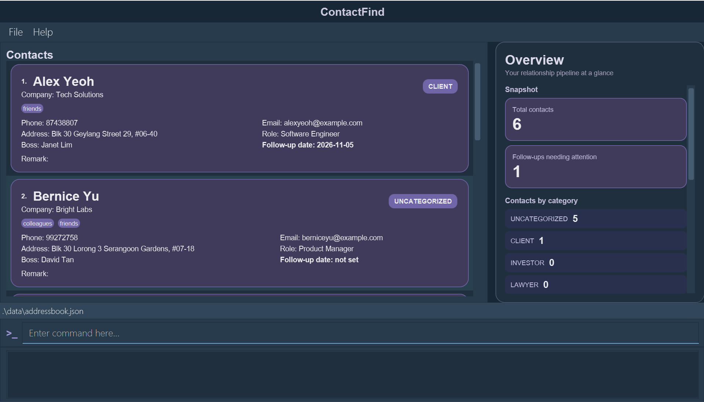

# ContactFind

**ContactFind is a desktop contact manager made specifically for investment bankers.**
It tracks the contacts' roles, companies, follow-up dates and interaction history.
Its CLI input method allows for quick command exectution,
while maintaining elegance by displaying the list of contacts in a GUI.

* If you are interested in using ContactFind, head over to the [_Quick Start_ section of the **User Guide**](UserGuide.html#quick-start).
* If you are interested in developing ContactFind, the [**Developer Guide**](DeveloperGuide.html) is a good place to start.

**Acknowledgements**

* Based on [AddressBook-Level3](https://github.com/se-edu/addressbook-level3) by the [SE-EDU initiative](https://se-education.org/).
* Libraries used: [JavaFX](https://openjfx.io/), [Jackson](https://github.com/junit-team/junit5), [JUnit5](https://github.com/junit-team/junit5)
